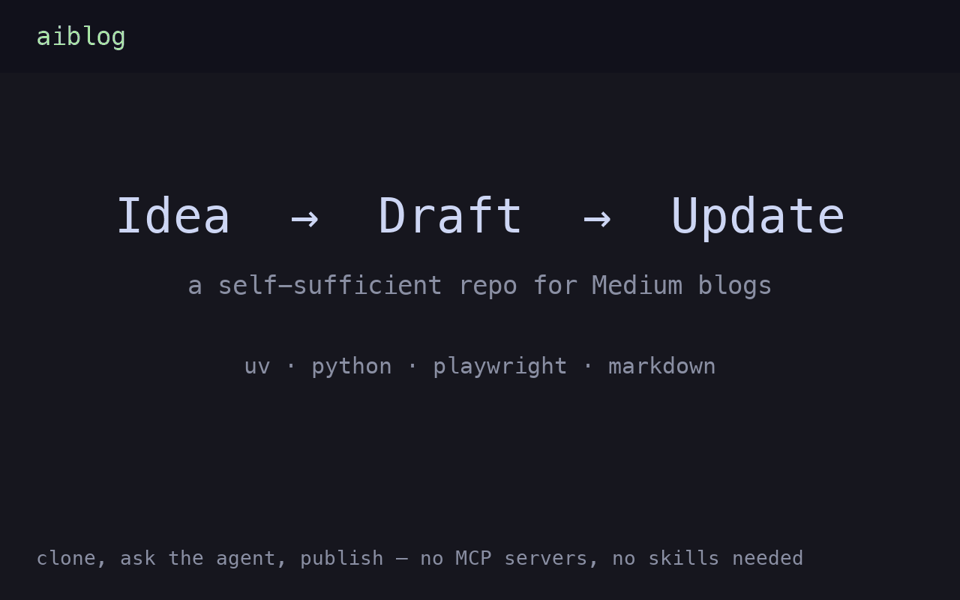

# aiblog — ideate, publish, and update Medium blogs from one repo

A self-sufficient repo for writing Medium posts with any coding agent (Claude
Code, Codex, Gemini CLI, Cursor: instructions live in `AGENTS.md`, which
`CLAUDE.md` imports). No MCP servers, no API keys, no third-party skills: just docs,
roadmaps, and `tools/` automation. Clone it, start your agent in it, and ask
it to write.

<video src="docs/demo.mp4" width="100%" controls></video>



## How easy is it?

```bash
git clone <this-repo-url> aiblog && cd aiblog
./scripts/setup.sh          # uv sync + browser install, asks your Medium @handle once
```

Then start a coding agent in this folder and just ask:

- *"What can you do?"* — it reads the repo docs and explains itself.
- *"Draft a roadmap for a series on Rust for data engineers"* — you get
  `roadmaps/rust-data.md` with phased topics; pick one.
- *"Write the next post"* — it grills you on angle and audience, drafts the
  post, **runs every code example for real**, screenshots the actual output,
  picks an **Unsplash cover** (the story thumbnail, credited), researches
  **Medium topics** with real story counts, and hands you a Medium draft URL.
- *"Update that draft — the intro is weak"* — it revises locally, re-verifies,
  and rewrites the **same draft in place**. No duplicates.
- *"Publish it live"* — only when you say so. It dry-runs the publish dialog
  (tags read back, thumbnail checked), shows you, then publishes.
- *"List my drafts"*, *"publish that old draft"*, *"import my old post on X
  and tighten it"* — older stories are listed by id, published live, or
  pulled into the repo and revised in place.

First Medium run opens a browser window: log in once, done.

## How it works

- **Repo is the source of truth.** Posts live in `posts/NN-slug/`
  (`post.md` + `code/` + `images/`). Medium drafts are disposable copies.
- **Nothing is faked.** Code is executed (`run_example.py`), screenshots render
  from real output (`render_output.py`), posts assemble from tested files
  (`build_post.py`). Unrun code is never published.
- **Draft-first.** Publishing creates drafts; going live needs your explicit
  say-so per post (`medium_golive.py`). Edits land on the same URL
  (`medium_edit.py`); revising a live post needs `--republish`.
- **Each post knows its story.** `posts/NN-slug/medium.json` records the
  Medium id, status, and URL, so no command ever needs a pasted draft id and
  duplicates are refused.
- **Two built-in skills** (`.claude/skills/`): `grilling` (nails the idea
  before drafting) and `medium` (owns a post end to end, with a writing bar).
- **Your own setup welcome.** Copy `CUSTOM.example.md` → `CUSTOM.md`
  (git-ignored) for voice/account/tag overrides; copy `.mcp.json.example` →
  `.mcp.json` for your own MCP servers; drop your own skills in
  `.claude/skills/`. The agent picks all of it up automatically.

## Make it yours

1. `cp .env.example .env` and set `MEDIUM_HANDLE` (used for links/footers).
2. `cp CUSTOM.example.md CUSTOM.md` and set your voice, tags, and defaults.
3. Optional: delete the example series (`roadmaps/`, `posts/`) and start your
   own with *"draft a roadmap for <your topic>"*. `STATE.md` + `ROADMAP.md`
   keep every session resumable, on any machine.

## Layout

`posts/NN-slug/{post.md,code/,images/}` · `roadmaps/<series>.md` ·
`ROADMAP.md` (index) · `STATE.md` (resume state) · `docs/WORKFLOW.md`
(full workflow) · `tools/` (scaffold, run, render, build, topics, cover,
publish, go live, edit, list, pull, demo builder) · `.claude/skills/{grilling,medium}`

## Requirements

git, [uv](https://docs.astral.sh/uv/), Python 3.12, a coding agent.
The browser automation needs a display for the headed window (Cloudflare
blocks headless); the login session is saved and reused.
